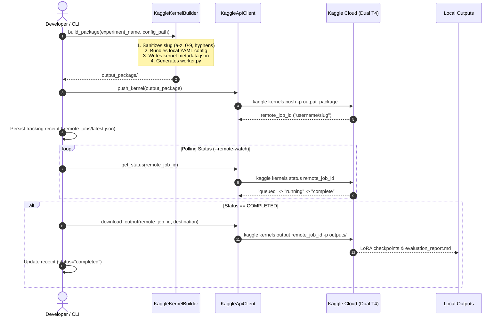

# Enterprise LLM Fine-Tuning & Engineering Handbook

A comprehensive, industry-grade reference guide covering LLM architectures, hardware requirements, mathematical sizing, quantization, fine-tuning methodologies, and production deployment.

---

## Table of Contents
1. [Enterprise Base Model Selection Guide](#1-enterprise-base-model-selection-guide)
2. [The 10-Phase Learning Roadmap](#2-the-10-phase-learning-roadmap)
3. [End-to-End Fine-Tuning Operational Workflow](#3-end-to-end-fine-tuning-operational-workflow)
4. [Phase 1 Deep Dive: Transformer Fundamentals](#4-phase-1-deep-dive-transformer-fundamentals)
   * [4.1 Tokenization](#41-tokenization)
   * [4.2 Embeddings](#42-embeddings)
   * [4.3 Positional Encoding & RoPE](#43-positional-encoding--rope)
   * [4.4 Scaled Dot-Product Attention](#44-scaled-dot-product-attention)
   * [4.5 Q / K / V Transformations](#45-q--k--v-transformations)
   * [4.6 Attention Evolution: MHA vs. MQA vs. GQA](#46-attention-evolution-mha-vs-mqa-vs-gqa)
   * [4.7 MLP & SwiGLU Network](#47-mlp--swiglu-network)
   * [4.8 LayerNorm vs. RMSNorm](#48-layernorm-vs-rmsnorm)
   * [4.9 Residual Connections](#49-residual-connections)
   * [4.10 LM Head & Logit Generation](#410-lm-head--logit-generation)
   * [4.11 PyTorch Reference Block](#411-pytorch-reference-block)
5. [Engineering & Architectural Doubts Deep Dive](#5-engineering--architectural-doubts-deep-dive)
   * [Doubt 1 & 15: LLM Anatomy, Tuning Targets & Layer Pruning](#doubt-1--15-llm-anatomy-tuning-targets--layer-pruning)
   * [Doubt 2 & 17: Parameter Sizing & Memory Formulas](#doubt-2--17-parameter-sizing--memory-formulas)
   * [Doubt 3: VRAM Sizing Chart & Load Calculation](#doubt-3-vram-sizing-chart--load-calculation)
   * [Doubt 4: Splitting Models Across GPU and CPU](#doubt-4-splitting-models-across-gpu-and-cpu)
   * [Doubt 5: Precision Formats (FP32, FP16, BF16, FP8, INT8, INT4)](#doubt-5-precision-formats-fp32-fp16-bf16-fp8-int8-int4)
   * [Doubt 6, 13 & 14: Quantization Spectrum (PTQ, QAT, NF4, AWQ, GPTQ, GGUF)](#doubt-6-13--14-quantization-spectrum-ptq-qat-nf4-awq-gptq-gguf)
   * [Doubt 7: Anatomical Breakdown of VRAM Consumption](#doubt-7-anatomical-breakdown-of-vram-consumption)
   * [Doubt 8: What is Accelerate?](#doubt-8-what-is-accelerate)
   * [Doubt 9: What is bitsandbytes & the Modern Ecosystem?](#doubt-9-what-is-bitsandbytes--the-modern-ecosystem)
   * [Doubt 10: Why PEFT (LoRA) Consumes GPU Memory](#doubt-10-why-peft-lora-consumes-gpu-memory)
   * [Doubt 11: All VRAM Consumers Beyond Model Weights](#doubt-11-all-vram-consumers-beyond-model-weights)
   * [Doubt 12: The KV Cache: Math, Sizing & Reduction Strategies](#doubt-12-the-kv-cache-math-sizing--reduction-strategies)
   * [Doubt 16: PyTorch Internals: grad, autograd, and requires_grad](#doubt-16-pytorch-internals-grad-autograd-and-requires_grad)
   * [Doubt 18: Accessing Free High-End Cloud GPUs](#doubt-18-accessing-free-high-end-cloud-gpus)
   * [Doubt 19: Gradients, Optimizers, and Activations Intuitive Guide](#doubt-19-gradients-optimizers-and-activations-intuitive-guide)
6. [Distributed Training Taxonomy & Scaling Strategies](#6-distributed-training-taxonomy--scaling-strategies)
   * [6.1 Parallelism Architectural Taxonomy](#61-parallelism-architectural-taxonomy)
   * [6.2 Standard Data Parallelism (PyTorch DDP)](#62-standard-data-parallelism-pytorch-ddp)
   * [6.3 Sharded Data Parallelism (DeepSpeed ZeRO & PyTorch FSDP)](#63-sharded-data-parallelism-deepspeed-zero--pytorch-fsdp)
   * [6.4 Tensor Parallelism (TP — Megatron-LM Style)](#64-tensor-parallelism-tp--megatron-lm-style)
   * [6.5 Pipeline Parallelism (PP)](#65-pipeline-parallelism-pp)
   * [6.6 Sequence & Context Parallelism (RingAttention & DeepSpeed Ulysses)](#66-sequence--context-parallelism-ringattention--deepspeed-ulysses)
   * [6.7 Enterprise Distributed Decision Matrix](#67-enterprise-distributed-decision-matrix)
7. [Enterprise Model Evaluation, Benchmarking & Production Telemetry](#7-enterprise-model-evaluation-benchmarking--production-telemetry)
   * [7.1 Holistic Evaluation Paradigm: Base vs. Fine-Tuned](#71-holistic-evaluation-paradigm-base-vs-fine-tuned)
   * [7.2 Deterministic Task-Specific Metrics](#72-deterministic-task-specific-metrics)
   * [7.3 Natural Language Generation (NLG) & Semantic Overlap Metrics](#73-natural-language-generation-nlg--semantic-overlap-metrics)
   * [7.4 Modern LLM-as-a-Judge & Evaluation Frameworks](#74-modern-llm-as-a-judge--evaluation-frameworks)
   * [7.5 RAG & Hallucination Metrics (The RAG Triad)](#75-rag--hallucination-metrics-the-rag-triad)
   * [7.6 Enterprise Safety, Alignment & Red-Teaming Audits](#76-enterprise-safety-alignment--red-teaming-audits)
   * [7.7 Production Serving Latency & Throughput Telemetry](#77-production-serving-latency--throughput-telemetry)
   * [7.8 Financial & Unit Economics: Cost per Request & Token Modeling](#78-financial--unit-economics-cost-per-request--token-modeling)
8. [Enterprise Remote Cloud Compute & Headless GPU Orchestration](#8-enterprise-remote-cloud-compute--headless-gpu-orchestration)
   * [8.1 Headless GPU Execution vs. Interactive Notebooks vs. SSH Tunnels](#81-headless-gpu-execution-vs-interactive-notebooks-vs-ssh-tunnels)
   * [8.2 Clean Architecture Compute Port (`IComputeProvider`)](#82-clean-architecture-compute-port-icomputeprovider)
   * [8.3 The Kaggle API Batch Lifecycle (Package, Push, Poll, Pull)](#83-the-kaggle-api-batch-lifecycle-package-push-poll-pull)
   * [8.4 Receipt Management & CLI Automation Workflow](#84-receipt-management--cli-automation-workflow)

---

## 1. Enterprise Base Model Selection Guide

Fine-tuning adapts existing behavior, formatting, and domain terminology; **it cannot teach foundation language reasoning from scratch**.

```
                           BASE MODEL SELECTION MATRIX

1. Task Nature:
   ├── Instruction / Conversational / Task QA ──► Instruct / Chat Model (e.g., Llama-3.1-8B-Instruct)
   ├── Continued Pre-training on Raw Corpus   ──► Base Model (e.g., Llama-3.1-8B)
   └── Preference Alignment (DPO / RLHF)      ──► SFT Checkpoint

2. Domain & Tokenizer Fit:
   ├── Mathematics, Finance, Table Math, Code ──► Qwen 2.5, DeepSeek
   ├── Tool Calling, Function Calling, Agents ──► Llama 3.1
   └── Multilingual (Asian / European)        ──► Qwen 2.5 (Asian/Global), Mistral (European)

3. Hardware & Compute Budget:
   ├── Laptop / Consumer GPU (<= 12GB VRAM)   ──► 0.5B – 3B models
   ├── Single Workstation GPU (16GB - 24GB)   ──► 7B – 14B models (via LoRA / QLoRA)
   └── Enterprise Node (Multi-GPU A100/H100)  ──► 70B models

4. Legal & Commercial Compliance:
   ├── Unrestricted Commercial Freedom        ──► Apache 2.0 / MIT (e.g., Qwen 2.5, Mistral-7B-v0.1)
   ├── Open Commercial (<700M Monthly Users)  ──► Llama 3.1 Community License
   └── Research Only                          ──► Avoid CC-BY-NC checkpoints in commercial products
```

---

## 2. The 10-Phase Learning Roadmap

```
PHASE 1 — Transformer Fundamentals
│  Tokenization, Embeddings, RoPE, Attention, Q/K/V, MHA/MQA/GQA, SwiGLU, RMSNorm, Residuals, LM Head
▼
PHASE 2 — Model Internals & Tensors
│  Parameters, State Dicts, PyTorch Tensors, Module Hierarchy, Trainable vs. Frozen Weights
▼
PHASE 3 — Numerical Computing & Precisions
│  FP32, FP16, BF16, FP8, INT8, INT4, Dynamic Ranges, Exponent vs. Mantissa
▼
PHASE 4 — GPU Memory Architecture
│  Static Weights, Gradients, Optimizer States, Activations, CUDA Buffers, KV Cache Math
▼
PHASE 5 — Quantization Engineering
│  PTQ vs. QAT, NormalFloat4 (NF4), Double Quantization, AWQ, GPTQ, GGUF, SmoothQuant
▼
PHASE 6 — Parameter-Efficient Fine-Tuning (PEFT)
│  LoRA Mechanics, QLoRA, Adapter Rank (r), Alpha Scaling, Target Modules, Dropout
▼
PHASE 7 — Training System Optimizations
│  Mixed Precision, Gradient Checkpointing, Gradient Accumulation, Paged Optimizers, FlashAttention-2
▼
PHASE 8 — Distributed Training & Scale
│  DDP, Hugging Face Accelerate, FSDP (ZeRO-3), DeepSpeed ZeRO-Offload, Tensor Parallelism
▼
PHASE 9 — Post-SFT Alignment & Preference Tuning
│  Supervised Fine-Tuning (SFT), DPO (Direct Preference Optimization), RLHF, PPO, Model Distillation
▼
PHASE 10 — Enterprise Production & MLOps
   Model Registry, Evaluation Gates, SafeTensors Merging, vLLM Serving, Continuous Batching, Observability
```

---

## 3. End-to-End Fine-Tuning Operational Workflow

```
                    [ 1. Define Business Task & Metric Targets ]
                                        │
                                        ▼
                    [ 2. Select Foundation Model (Size, License, Domain) ]
                                        │
                                        ▼
                    [ 3. Audit Architecture (Q/K/V Heads, Vocab Size, RoPE) ]
                                        │
                                        ▼
                    [ 4. Compute Hardware Memory Budget & Batch Limits ]
                                        │
                                        ▼
                    [ 5. Choose Precision Strategy (BF16 vs. FP16) ]
                                        │
                                        ▼
                    [ 6. Choose Quantization Strategy (None vs. 4-bit NF4) ]
                                        │
                                        ▼
                    [ 7. Configure PEFT Strategy (LoRA: r, alpha, target_modules) ]
                                        │
                                        ▼
                    [ 8. Select Memory Optimizers (paged_adamw_8bit) ]
                                        │
                                        ▼
                    [ 9. Execute Fine-Tuning Loop (SFTTrainer + FlashAttention) ]
                                        │
                                        ▼
                    [ 10. Automated Model Evaluation (EM, Token F1, ROUGE-L) ]
                                        │
                                        ▼
                    [ 11. Evaluate Quality Gate (Pass -> Proceed | Fail -> Retune) ]
                                        │
                                        ▼
                    [ 12. Export & Merge LoRA Adapter to Base Model ]
                                        │
                                        ▼
                    [ 13. Production Quantization if needed (AWQ / FP8) ]
                                        │
                                        ▼
                    [ 14. High-Throughput Serving (vLLM / TensorRT-LLM) ]
```

---

## 4. Phase 1 Deep Dive: Transformer Fundamentals

### 4.1 Tokenization
Text strings are translated into sequences of integer vocabulary IDs.

* **Byte-Level BPE (Byte Pair Encoding)**: Starts with all 256 individual byte values (`0x00`–`0xFF`) and iteratively merges the most frequent adjacent pairs.
* **Zero Out-of-Vocabulary (OOV)**: Any unknown word decomposes into its raw UTF-8 byte tokens without ever producing an `<UNK>` token.
* **Vocabulary Impact**:
  $$\text{Embedding Memory} = V_{\text{vocab}} \times d_{\text{model}} \times \text{bytes\_per\_param}$$
  Qwen 2.5 uses $V = 152{,}064$, providing strong compression for code, math, and multilingual text.

### 4.2 Embeddings
The token embedding matrix $W_{\text{embed}} \in \mathbb{R}^{V \times d_{\text{model}}}$ maps token IDs to dense vectors via index lookup (`torch.gather`).
* **Untied Embeddings** (Llama 3, Qwen 2.5): The input embedding and output LM Head maintain separate weight matrices, improving representational capacity.
* **Tied Embeddings** (Gemma): Reuses $W_{\text{embed}}^T$ as the output projection, saving memory on smaller architectures.

### 4.3 Positional Encoding & RoPE
Self-attention is permutation invariant. Rotary Position Embedding (**RoPE**) injects relative ordering by rotating Query and Key vectors in 2D sub-spaces:

$$R_{\Theta, m} = \begin{pmatrix} \cos m\theta_i & -\sin m\theta_i \\ \sin m\theta_i & \cos m\theta_i \end{pmatrix}$$

$$\langle R_{\Theta, m} Q_m, R_{\Theta, n} K_n \rangle = \mathbf{Q_m^T R_{\Theta, n - m} K_n}$$

The inner product depends solely on relative distance $(n - m)$. Frequency scaling (YaRN, NTK-aware) enables extending context windows from 8K to 128K+ tokens.

### 4.4 Scaled Dot-Product Attention
$$\mathbf{\text{Attention}(Q, K, V) = \text{Softmax}\left( \frac{Q K^T}{\sqrt{d_k}} + M \right) V}$$

* **Scaling Factor $\frac{1}{\sqrt{d_k}}$**: For head dimension $d_k = 128$, the variance of dot-products is 128. Scaling keeps variance near $1.0$, preventing the Softmax from saturating and zeroing out backpropagation gradients.
* **Causal Mask ($M$)**: Sets future token positions to $-\infty$ so token $t$ cannot access tokens $t+1 \dots N$.

### 4.5 Q / K / V Transformations
* **Query ($Q = X W_q$)**: Encodes what information the current token is seeking.
* **Key ($K = X W_k$)**: Encodes what information the token offers.
* **Value ($V = X W_v$)**: The actual payload retrieved when Query and Key align.

### 4.6 Attention Evolution: MHA vs. MQA vs. GQA
```
  MHA (Multi-Head Attention)         GQA (Grouped-Query Attention)         MQA (Multi-Query Attention)
  Queries    Keys    Values           Queries       Keys   Values          Queries     Keys   Values
   Q Q Q Q    K K K K  V V V V         Q Q Q Q       K      V              Q Q Q Q      K      V
   │ │ │ │    │ │ │ │  │ │ │ │         ├───┴───┤     │      │              ├───┴───┴──┤ │      │
   ▼ ▼ ▼ ▼    ▼ ▼ ▼ ▼  ▼ ▼ ▼ ▼         ▼       ▼     ▼      ▼              ▼          ▼ ▼      ▼
  8 Q-Heads  8 K-Heads 8 V-Heads      8 Q-Heads  2 K-Heads 2 V-Heads       8 Q-Heads  1 K-Head 1 V-Head
  (Llama 1, GPT-3)                    (Llama 3, Qwen 2.5, Mistral)         (Falcon, StarCoder)
  KV Cache: 100%                      KV Cache: 25% (4x reduction!)        KV Cache: 12.5% (8x reduction!)
```
* **Grouped-Query Attention (GQA)**: Shares a single Key and Value head across a group of Query heads (e.g., 32 Q-heads and 8 KV-heads $\rightarrow$ 4:1 ratio). Reduces KV cache footprint by **4x to 8x** with no degradation in reasoning quality.

### 4.7 MLP & SwiGLU Network
While Attention routes context between tokens, the **Feed-Forward Network (FFN)** stores and recalls factual knowledge.
$$\mathbf{\text{SwiGLU}(x) = \left( \text{Swish}(x W_{\text{gate}}) \odot (x W_{\text{up}}) \right) W_{\text{down}}}$$
* The gating branch ($W_{\text{gate}}$) acts as a non-linear filter controlling what information passes forward from $W_{\text{up}}$.
* Intermediate dimension is sized to $d_{\text{ff}} \approx \frac{8}{3}d_{\text{model}}$ (aligned to multiples of 256 for GPU tensor core efficiency).

### 4.8 LayerNorm vs. RMSNorm
$$\mathbf{\text{RMSNorm}(x) = \frac{x}{\sqrt{\frac{1}{d} \sum_{i=1}^d x_i^2 + \epsilon}} \odot \gamma}$$
* **RMSNorm** removes mean-centering, computing variance directly from raw values. This saves memory bandwidth and speeds up normalization by 10%–50%.
* **Pre-LN Architecture**: Normalizing before sub-layers ($x + \text{Sublayer}(\text{Norm}(x))$) maintains stable gradient propagation across 100+ stacked blocks.

### 4.9 Residual Connections
$$x_{l+1} = x_l + \mathcal{F}(x_l)$$
$$\frac{\partial \mathcal{E}}{\partial x_l} = \frac{\partial \mathcal{E}}{\partial x_L} \left( \mathbf{I} + \frac{\partial}{\partial x_l} \sum_{i=l}^{L-1} \mathcal{F}(x_i) \right)$$
The identity term ($\mathbf{I}$) ensures that gradients flow back through the entire depth of the network without vanishing.

### 4.10 LM Head & Logit Generation
Projects the final residual hidden state to vocabulary space:
$$\text{Logits} = x_{\text{final}} W_{\text{head}}, \qquad P(w_i) = \frac{\exp(\text{Logit}_i / T)}{\sum_j \exp(\text{Logit}_j / T)}$$
* Temperature ($T$) controls distribution sharpness: lower $T$ favors greedy factual output, higher $T$ increases randomness.

---

### 4.11 PyTorch Reference Block

```python
import torch
import torch.nn as nn
import torch.nn.functional as F

class RMSNorm(nn.Module):
    def __init__(self, dim: int, eps: float = 1e-6):
        super().__init__()
        self.eps = eps
        self.weight = nn.Parameter(torch.ones(dim))

    def forward(self, x: torch.Tensor) -> torch.Tensor:
        variance = x.pow(2).mean(-1, keepdim=True)
        return x * torch.rsqrt(variance + self.eps) * self.weight

class SwiGLUMLP(nn.Module):
    def __init__(self, d_model: int, d_ff: int):
        super().__init__()
        self.gate_proj = nn.Linear(d_model, d_ff, bias=False)
        self.up_proj = nn.Linear(d_model, d_ff, bias=False)
        self.down_proj = nn.Linear(d_ff, d_model, bias=False)

    def forward(self, x: torch.Tensor) -> torch.Tensor:
        return self.down_proj(F.silu(self.gate_proj(x)) * self.up_proj(x))

class TransformerBlock(nn.Module):
    def __init__(self, d_model: int, d_ff: int, num_heads: int, num_kv_heads: int):
        super().__init__()
        self.input_layernorm = RMSNorm(d_model)
        self.post_attention_layernorm = RMSNorm(d_model)
        self.mlp = SwiGLUMLP(d_model, d_ff)

        self.head_dim = d_model // num_heads
        self.q_proj = nn.Linear(d_model, num_heads * self.head_dim, bias=False)
        self.k_proj = nn.Linear(d_model, num_kv_heads * self.head_dim, bias=False)
        self.v_proj = nn.Linear(d_model, num_kv_heads * self.head_dim, bias=False)
        self.o_proj = nn.Linear(d_model, d_model, bias=False)

    def forward(self, x: torch.Tensor) -> torch.Tensor:
        # Pre-LN Self-Attention with Residual
        normed = self.input_layernorm(x)
        q, k, v = self.q_proj(normed), self.k_proj(normed), self.v_proj(normed)
        attn_out = self.o_proj(q)
        x = x + attn_out

        # Pre-LN SwiGLU MLP with Residual
        x = x + self.mlp(self.post_attention_layernorm(x))
        return x
```

---

## 5. Engineering & Architectural Doubts Deep Dive

### Doubt 1 & 15: LLM Anatomy, Tuning Targets & Layer Pruning

#### Layer Roles in Fine-Tuning:
* **Attention Layers (`q_proj`, `k_proj`, `v_proj`, `o_proj`)**: Control how information flows between tokens. Fine-tuning these adapts style, instruction following, and conversational tone.
* **MLP Layers (`gate_proj`, `up_proj`, `down_proj`)**: Store factual associations and domain knowledge. Fine-tuning MLPs is critical for specialized domains (medicine, finance, law).
* **Embeddings & LM Head**: Maintain general vocabulary representations. Leave frozen unless adding new special tokens.

#### Layer Dropping (Pruning for Inference Speedup):
* **Mechanism**: Compute the cosine similarity of hidden states between consecutive layers across validation samples:
  $$\text{Angular Distance} = \frac{1}{\pi} \arccos\left(\frac{x_l \cdot x_{l+1}}{\|x_l\| \|x_{l+1}\|}\right)$$
* Layers with near-zero angular distance (typically middle layers) contribute minimal unique representation and can be pruned entirely (dropping 15–20% of layers yields 15–20% latency reduction).

---

### Doubt 2 & 17: Parameter Sizing & Memory Formulas

#### Parameter Counting Formula:
$$N_{\text{total}} = 2(V \times d) + L \times \left[ d^2 \left(2 + 2\frac{h_{kv}}{h_q}\right) + 3(d \times d_{\text{ff}}) + 2d \right]$$

#### Mixed-Precision Calculation Across Layers:
When different modules run at different precisions (e.g. QLoRA with 4-bit linear layers and 16-bit embeddings):
$$\mathbf{\text{Total Static VRAM} = \sum_{i} \left( N_i \times \text{Bytes}(P_i) \right)}$$

* $P = 2$ bytes for FP16/BF16
* $P = 1$ byte for INT8 / FP8
* $P = 0.5$ bytes for INT4 / NF4

---

### Doubt 3: VRAM Sizing Chart & Load Calculation

$$\mathbf{\text{VRAM}_{\text{load}} \approx (\text{Parameter Count in Billions} \times \text{Bytes per Param}) \times 1.25}$$

| Model Size | 16-bit Native (`bfloat16`) | 8-bit (`INT8`) | 4-bit (`QLoRA / AWQ`) | Minimum Hardware Class |
| :--- | :---: | :---: | :---: | :--- |
| **0.5B** | `~1.2 GB` | `~0.8 GB` | `~0.6 GB` | Laptop GPU / Free Colab T4 |
| **1.5B** | `~3.5 GB` | `~2.1 GB` | `~1.5 GB` | 6 GB Laptop GPU |
| **3B** | `~6.8 GB` | `~3.8 GB` | `~2.6 GB` | 8 GB GPU (RTX 4060) |
| **7B / 8B** | `~16.0 GB` | `~9.0 GB` | `~6.0 GB` | 16 GB – 24 GB GPU (A10G, RTX 4090) |
| **14B** | `~30.0 GB` | `~16.5 GB` | `~10.0 GB` | 24 GB GPU (A10G, RTX 3090/4090) |
| **70B** | `~145.0 GB` | `~78.0 GB` | `~42.0 GB` | 2x – 4x A100/H100 (80GB) |

---

### Doubt 4: Splitting Models Across GPU and CPU

* **Supported for Inference**:
  ```python
  max_memory = {0: "4.5GiB", "cpu": "24GiB"}
  model = AutoModelForCausalLM.from_pretrained(model_id, device_map="auto", max_memory=max_memory)
  ```
* **Why It Fails for 4-bit Training**:
  1. `bitsandbytes` 4-bit matrix multiplication kernels are compiled strictly for NVIDIA CUDA. There is no CPU implementation.
  2. PCIe bus bandwidth (16–64 GB/s) is 10x–50x slower than GPU VRAM (900–3,300 GB/s), causing a severe bottleneck.
* **Enterprise Solution**: Use **DeepSpeed ZeRO-Stage 3 Offload**, which leaves model forward/backward passes on GPU while offloading AdamW optimizer states to CPU RAM.

---

### Doubt 5: Precision Formats (FP32, FP16, BF16, FP8, INT8, INT4)

```
FP32 (32-bit): [1 sign][  8-bit Exponent  ][               23-bit Mantissa               ]
FP16 (16-bit): [1 sign][ 5 exp ][ 10 mantissa ]
BF16 (16-bit): [1 sign][  8-bit Exponent  ][ 7 mantissa ]
INT8  (8-bit): [ Discrete Integer: -128 to 127 ]
INT4  (4-bit): [ 16 Discrete Bins: e.g. NormalFloat4 ]
FP8   (8-bit): E4M3 (4 exp, 3 mantissa) or E5M2 (5 exp, 2 mantissa)
```

* **FP32**: Highest numerical stability; required for master weights and loss accumulators.
* **FP16**: Prone to underflow/overflow (NaNs); requires dynamic loss scaling.
* **BF16**: **Enterprise training standard**. Same dynamic range as FP32 ($10^{\pm 38}$), eliminating gradient clipping and loss scaling issues.
* **FP8**: Native hardware support in NVIDIA Hopper (H100) and Ada Lovelace architectures; enables 2x throughput over 16-bit.

---

### Doubt 6, 13 & 14: Quantization Spectrum (PTQ, QAT, NF4, AWQ, GPTQ, GGUF)

| Quantization Format | Target Phase | Method | Hardware Environment |
| :--- | :--- | :--- | :--- |
| **NF4 (`bitsandbytes`)** | **Training (QLoRA)** | NormalFloat distribution matching Gaussian weight curves | CUDA GPUs |
| **AWQ** | **Production Serving** | Preserves salient 1% weight channels based on activations | GPU Serving (`vLLM`, TensorRT-LLM) |
| **GPTQ** | **Production Serving** | Second-order inverse Hessian error minimization | GPU Serving (`AutoGPTQ`) |
| **GGUF** | **Edge / On-Device** | Binary single-file format with mixed k-quantizations | CPU, Apple Silicon (`llama.cpp`, Ollama) |
| **SmoothQuant** | **W8A8 Serving** | Migrates activation outliers into weights for integer matrix math | Enterprise Inference Clusters |

* **QLoRA vs. QAT**: QLoRA freezes a 4-bit base model and trains 16-bit adapters without modifying base weights. QAT simulates quantization rounding across the entire network to update all weights.

---

### Doubt 7: Anatomical Breakdown of VRAM Consumption

During fine-tuning, VRAM contains:
1. **4-Bit Model Weights**: Linear layers compressed to 0.5 bytes per parameter.
2. **Quantization Metadata**: Scale constants ($\alpha$) and zero-points ($z$) needed to reconstruct weights on the fly.
3. **Unquantized Modules**: `embed_tokens` and `lm_head` in native 16-bit (consumes ~2.2 GB on Qwen2.5-7B).
4. **Model Buffers**: Fixed tensors like RoPE pre-computed sine/cosine matrices.
5. **CUDA Runtime Context**: 500 MB – 1 GB allocated by the CUDA driver upon initialization.
6. **Temporary Loading Memory**: Transient memory spikes during safetensors deserialization.
7. **PyTorch Allocator Fragmentation**: Reserved memory held by the caching allocator to reduce OS allocation overhead.

---

### Doubt 8: What is Accelerate?

Hugging Face **`accelerate`** is a unified abstraction layer over hardware configurations.

```
                  Your Training Loop Code
                             │
                             ▼
                  Hugging Face Accelerate
                             │
        ┌────────────────────┼────────────────────┐
        ▼                    ▼                    ▼
   Single GPU         Multi-GPU (DDP)      FSDP / DeepSpeed
```
It handles device placement (`device_map="auto"`), distributed communication, mixed-precision casting, and optimizer sharding without requiring changes to user code.

---

### Doubt 9: What is bitsandbytes & the Modern Ecosystem?

* **`bitsandbytes`**: Low-level library with custom CUDA kernels providing 8-bit optimizers (`paged_adamw_8bit`) and 4-bit NF4 linear layers.
* **Complementary Ecosystem**:
  * **`FlashAttention-2`**: Fuses Softmax and reduction passes inside GPU SRAM, reducing memory from $O(N^2)$ to $O(N)$ and accelerating training 2x–4x.
  * **`Unsloth`**: Custom backward-pass CUDA kernels that reduce VRAM by up to 70% and accelerate LoRA training.
  * **`vLLM`**: Production serving engine using **PagedAttention** for high-throughput continuous batching.
  * **`DeepSpeed`**: Microsoft framework providing ZeRO memory sharding across distributed clusters.

---

### Doubt 10: Why PEFT (LoRA) Consumes GPU Memory

LoRA introduces low-rank decomposition matrices ($W = W_0 + \frac{\alpha}{r} B A$). Even with small rank $r$, VRAM is required for:
1. **Adapter Weights ($A$ and $B$)**: Trainable float16/bfloat16 parameters.
2. **Adapter Gradients ($\nabla A$ and $\nabla B$)**: Stored during the backward pass.
3. **AdamW Optimizer States**: Stores 1st and 2nd momentum in FP32 ($8\text{ bytes per adapter parameter}$).
4. **Intermediate Activations**: Activation outputs of matrix $A$ across sequence lengths needed to compute gradients for matrix $B$.

---

### Doubt 11: All VRAM Consumers Beyond Model Weights

$$\mathbf{\text{Total VRAM} = \text{Weights} + \text{Gradients} + \text{Optimizer States} + \text{Activations} + \text{KV Cache} + \text{Workspace}}$$

1. **Activations**: Stored forward-pass states required for chain-rule derivative calculations.
2. **Gradients**: First-order partial derivatives ($\frac{\partial \mathcal{L}}{\partial W}$).
3. **Optimizer States**: Historical momentum vectors (AdamW tracks velocity and variance).
4. **KV Cache**: Cached Key and Value vectors during generation.
5. **cuBLAS Workspace**: Temporary buffers used by CUDA for matrix multiplication operations.
6. **CUDA Context**: Static memory reserved by the GPU driver runtime.

---

### Doubt 12: The KV Cache: Math, Sizing & Reduction Strategies

Autoregressive models re-use past Key and Value representations rather than recomputing them at each step.

$$\mathbf{\text{Size}_{\text{KVCache}} = 2 \times \text{batch\_size} \times \text{sequence\_length} \times L \times h_{kv} \times d_{\text{head}} \times P}$$

#### Sizing Example:
For `Llama-3.1-8B` ($L=32, h_{kv}=8, d_{\text{head}}=128$, in FP16 $P=2$):
$$\text{Memory per Token} = 2 \times 32 \times 8 \times 128 \times 2 = \mathbf{131{,}072\text{ bytes}} \approx \mathbf{128\text{ KB / token}}$$
At batch size $16$ and context length $8{,}192$:
$$16 \times 8{,}192 \times 128\text{ KB} \approx \mathbf{16.7\text{ GB VRAM}}$$

#### Reduction Strategies:
1. **Grouped-Query Attention (GQA)**: Slashes KV heads by 4x to 8x natively.
2. **PagedAttention (`vLLM`)**: Allocates KV cache in non-contiguous virtual memory pages, recovering 60–80% of wasted memory padding.
3. **KV Cache Quantization**: Stores cached tokens in **FP8** or **INT4**, cutting footprint by 50% to 75%.
4. **Sliding Window Attention (SWA)**: Caps memory usage to a fixed history window (e.g. 4,096 tokens).

---

### Doubt 16: PyTorch Internals: grad, autograd, and requires_grad

* **`requires_grad`**: Boolean attribute on PyTorch tensors.
  * `False` $\rightarrow$ The tensor is frozen. No graph is constructed, saving memory.
  * In LoRA: Base weights have `requires_grad = False`; adapter weights have `requires_grad = True`.
* **`grad`**: The attribute where the computed derivative $\frac{\partial \mathcal{L}}{\partial W}$ is written during `.backward()`. Matches the tensor's shape exactly.
* **`autograd`**: PyTorch's automatic differentiation engine that constructs the execution graph and executes backpropagation.

---

### Doubt 18: Accessing Free High-End Cloud GPUs

| Platform | Free Hardware Tier | Limits | Best For |
| :--- | :--- | :--- | :--- |
| **Kaggle Notebooks** | **2x NVIDIA T4 (32 GB total VRAM)** | 30 hours / week | Multi-GPU DDP training via `accelerate launch` |
| **Google Colab** | **1x NVIDIA T4 (16 GB VRAM)** | Dynamic session limits | Single-GPU 7B/8B QLoRA fine-tuning |
| **Lightning.ai** | **NVIDIA L4 (24 GB) / A10G** | Monthly credit allocation | 7B LoRA / 14B QLoRA experimentation |

---

### Doubt 19: Gradients, Optimizers, and Activations Intuitive Guide

```
[ Input Tokens ] ──► FORWARD PASS ──► [ Activations (Saved intermediate outputs) ] ──► Loss
                                                                                        │
[ Updated Weights ] ◄── OPTIMIZER ◄── [ Gradients (Direction of steepest ascent) ] ◄────┘
```

1. **Activations**: Intermediate layer values produced during the forward pass and retained in memory for use in the chain rule during backpropagation.
2. **Gradients**: The directional slope ($\frac{\partial \text{Loss}}{\partial W}$) indicating how changing each parameter affects error.
3. **Optimizer (e.g., AdamW)**: Adjusts parameter weights using current gradients and running averages of past momentum.

---

## 6. Distributed Training Taxonomy & Scaling Strategies

Training and fine-tuning large language models frequently exceeds the memory and compute capacity of a single GPU. Distributed training partitions computation, memory, or both across an accelerator cluster.

### 6.1 Parallelism Architectural Taxonomy

```
                       DISTRIBUTED PARALLELISM DIMENSIONS
                                       │
        ┌──────────────────────────────┼──────────────────────────────┐
        ▼                              ▼                              ▼
  DATA PARALLELISM             MODEL PARALLELISM              CONTEXT PARALLELISM
  (Batch Sharding)          (Layer / Weight Sharding)         (Sequence Sharding)
        │                              │                              │
  ┌─────┴──────────────┐         ┌─────┴──────────────┐               │
  ▼                    ▼         ▼                    ▼               ▼
Standard DDP        Sharded DDP  Tensor (TP)      Pipeline (PP)   RingAttention /
(Replication)      (ZeRO / FSDP) (Intra-layer)   (Inter-layer)    DeepSpeed Ulysses
```

---

### 6.2 Standard Data Parallelism (PyTorch DDP)

* **Architecture & Mechanics**:
  * An identical copy of the full model and optimizer states resides on every GPU in the cluster.
  * The global training batch is partitioned into distinct micro-batches across GPUs.
  * **Backward Pass Synchronization**: Each GPU computes local gradients independently. Before the optimizer step, an `AllReduce` collective communication operation averages gradients across all GPUs, and optimizer states update locally in lockstep.
* **Optimal Use Cases**:
  * Models that fit entirely on a single GPU along with their optimizer states and activations (e.g., 0.5B–3B base models, or 7B–14B models tuned via QLoRA).
  * High-efficiency linear throughput scaling when communication overhead is low.
* **Limitations & Enterprise Bottlenecks**:
  * **Memory Redundancy**: An $N$-GPU cluster stores $N$ exact duplicate copies of weights and optimizer states, wasting massive amounts of aggregate cluster VRAM.

---

### 6.3 Sharded Data Parallelism (DeepSpeed ZeRO & PyTorch FSDP)

Pioneered by Microsoft (**DeepSpeed ZeRO** — Zero Redundancy Optimizer) and standardized natively in PyTorch (**FSDP** — Fully Sharded Data Parallel), sharded data parallelism eliminates memory redundancy by partitioning training states across available GPUs while retaining the operational simplicity of data parallelism.

```
                      ZeRO MEMORY PARTITIONING SPECTRUM

  Native DDP:    [ Weights ][ Gradients ][ Optimizer States ] (Duplicated per GPU)
                      │
  ZeRO-Stage 1:  [ Weights ][ Gradients ][ Opt State / N ]    (~4x memory reduction)
                      │
  ZeRO-Stage 2:  [ Weights ][ Grad / N  ][ Opt State / N ]    (~8x memory reduction)
                      │
  ZeRO-Stage 3:  [ W / N   ][ Grad / N  ][ Opt State / N ]    (Linear N-fold reduction)
```

#### ZeRO / FSDP Stage Comparison

| Level | Partitioned State | Memory Reduction | Communication Pattern | Enterprise Operational Profile |
| :--- | :--- | :---: | :--- | :--- |
| **ZeRO-1** | Optimizer States | $\approx 4\times$ | Standard `AllReduce` on gradients | Baseline sharding; zero runtime overhead during forward pass. |
| **ZeRO-2** | Optimizer States + Gradients | $\approx 8\times$ | `ReduceScatter` on gradients, then local updates | Standard choice for 7B–14B full LoRA fine-tuning across multi-GPU nodes. |
| **ZeRO-3 / FSDP Full Shard** | Optimizer States + Gradients + Model Weights | Linear with GPU count ($N\times$) | Just-in-Time `AllGather` before layer forward/backward, immediate discard | Zero state redundancy. Enables 70B parameter full fine-tuning on commodity GPU nodes. |

> [!TIP]
> **CPU Offloading (ZeRO-Offload / FSDP CPU Offload)**:
> In severely memory-constrained clusters (e.g., 2× 24GB GPUs), ZeRO-3 / FSDP can offload optimizer states and inactive layer weights to host system RAM over the PCIe bus. This allows training 70B models on budget nodes without renting high-cost H100 clusters, trading PCIe transfer latency for capacity.

---

### 6.4 Tensor Parallelism (TP — Megatron-LM Style)

* **Architecture & Mechanics**:
  * Slices individual weight matrices **within** each transformer block across GPUs.
  * **Attention Module**: The Query ($W_q$), Key ($W_k$), and Value ($W_v$) projection matrices are column-partitioned across GPUs, while the Output projection ($W_o$) is row-partitioned with a single `AllReduce` operation.
  * **MLP Module**: The Gate ($W_{\text{gate}}$) and Up ($W_{\text{up}}$) projections are column-partitioned; the Down projection ($W_{\text{down}}$) is row-partitioned with an `AllReduce`.
* **Hardware & Interconnect Requirements**:
  * **Extreme Bandwidth Sensitivity**: Tensor parallelism executes multiple collective operations per transformer layer. It requires intra-node ultra-high-speed interconnects (NVIDIA NVLink / NVSwitch @ 900 GB/s to 3.2 TB/s).
  * **Warning**: Running Tensor Parallelism across standard PCIe or Ethernet links will cause catastrophic communication stalls.
* **Optimal Use Cases**:
  * Massive models (70B, 405B) where a single layer's activation memory exceeds the VRAM of an individual GPU.

---

### 6.5 Pipeline Parallelism (PP)

* **Architecture & Mechanics**:
  * Layers are partitioned sequentially across consecutive GPUs (e.g., GPU 0 hosts Layers 1–8, GPU 1 hosts Layers 9–16, etc.).
  * **The Pipeline Bubble**: Simple sequential execution causes downstream GPUs to sit idle while waiting for upstream forward/backward passes.
  * **Mitigation (1F1B Scheduling)**: The One-Forward-One-Backward schedule interleaves micro-batches so that each GPU immediately executes a backward pass for a completed micro-batch while other micro-batches advance, minimizing bubble overhead to $\frac{p - 1}{m}$ (where $p$ is pipeline stages and $m$ is micro-batches).
* **Optimal Use Cases**:
  * Multi-node clusters connected by lower-bandwidth networks (e.g., standard InfiniBand or 100GbE). PP transmits only layer boundary activation tensors rather than full parameter matrices.

---

### 6.6 Sequence & Context Parallelism (RingAttention & DeepSpeed Ulysses)

* **The Problem**: Ultra-long context windows (32K, 128K, 1M+ tokens) cause attention activation matrices ($O(N^2)$ memory scaling) to exceed GPU VRAM, even when model parameters fit comfortably.
* **Mechanisms**:
  * **RingAttention**: Partitions the sequence length across GPUs. Key and Value blocks are passed asynchronously in a ring topology across accelerators while overlapping communication with local attention computation.
  * **DeepSpeed Ulysses**: Shards sequences across GPUs, executes an `All-to-All` collective communication to aggregate attention heads locally, computes attention, and executes an inverse `All-to-All` to restore sequence partitioning.

---

### 6.7 Enterprise Distributed Decision Matrix

| Model Parameter Scale | Tuning Paradigm | Minimum Recommended Hardware | Distributed Strategy | Target Framework |
| :--- | :--- | :--- | :--- | :--- |
| **0.5B – 3B** | Full Fine-Tuning / LoRA | 1× Consumer GPU (RTX 4090 / T4) | `single_gpu` or DDP | Hugging Face TRL / Accelerate |
| **7B – 14B** | 4-bit QLoRA | 1× Workstation GPU (16GB – 24GB VRAM) | `single_gpu` | Unsloth / PEFT + bitsandbytes |
| **7B – 14B** | Full 16-bit LoRA | 2× – 4× GPUs (A10G / L4 / A100 40GB) | PyTorch FSDP (ZeRO-2 equivalent) | PyTorch FSDP / Accelerate |
| **7B – 14B** | Full Parameter Fine-Tuning | 4× – 8× GPUs (A100 80GB / H100) | PyTorch FSDP Full Shard (ZeRO-3) | PyTorch FSDP / DeepSpeed |
| **70B** | 4-bit QLoRA | 2× – 4× GPUs (24GB – 48GB VRAM) | FSDP / ZeRO-3 with QLoRA | Hugging Face Accelerate + PEFT |
| **70B** | Full 16-bit LoRA / Full FT | 8× A100 / H100 (80GB each) | FSDP Full Shard or ZeRO-3 | PyTorch FSDP / DeepSpeed ZeRO-3 |
| **405B+** | Frontier Enterprise Scale | Multi-Node Cluster (32–128+ H100s) | 3D Parallelism (TP + PP + FSDP) | Megatron-Core / DeepSpeed |

---

## 7. Enterprise Model Evaluation, Benchmarking & Production Telemetry

Enterprise adoption requires rigorous, multi-dimensional verification. A successful fine-tuning run must demonstrate quantifiable domain uplift, zero catastrophic forgetting of core reasoning, strict adherence to schema/format specifications, hardened safety alignment, and sub-second latency SLAs.

### 7.1 Holistic Evaluation Paradigm: Base vs. Fine-Tuned

Evaluation must never rely solely on training loss convergence. Enterprise teams execute comparative delta benchmarks between the **Base Foundation Model** and the **Fine-Tuned Checkpoint**:

```
                  ENTERPRISE QUALITY EVALUATION PIPELINE
                                     │
      ┌──────────────────────────────┼──────────────────────────────┐
      ▼                              ▼                              ▼
TASK CAPABILITY               SAFETY & GOVERNANCE            PRODUCTION SERVING
• Domain Exact Match          • Toxicity & PII Leakage       • TTFT & TPOT (P95/P99)
• Format / Schema Syntax      • Prompt Injection Defense     • Throughput (Tokens/s)
• Downstream Accuracy/F1      • Hallucination & Grounding    • Unit Economics ($/1k req)
      │                              │                              │
      └──────────────────────────────┼──────────────────────────────┘
                                     ▼
                      [ EVALUATION QUALITY GATE ]
                 ├── Pass ──► Model Registry & Merge SafeTensors
                 └── Fail ──► Hyperparameter / Dataset Retuning
```

* **Core Assessment Dimensions**:
  1. **Domain Uplift**: Quantifiable score increases on customer-specific target tasks.
  2. **Format Fidelity**: Syntax validation on structured generation (JSON, XML, Tool Calls).
  3. **Regression & Forgetting**: Evaluating foundational reasoning (MMLU, GSM8K, ARC) to verify general intelligence is preserved.
  4. **Win-Rate Head-to-Head**: Blind pairwise LLM judge evaluation against the baseline model.

---

### 7.2 Deterministic Task-Specific Metrics

#### A. Classification Tasks
For intent detection, sentiment routing, and categorical document classification:

$$\text{Accuracy} = \frac{\text{TP} + \text{TN}}{\text{TP} + \text{TN} + \text{FP} + \text{FN}}, \qquad \text{Precision} = \frac{\text{TP}}{\text{TP} + \text{FP}}, \qquad \text{Recall} = \frac{\text{TP}}{\text{TP} + \text{FN}}$$

$$\mathbf{F_1 = 2 \times \frac{\text{Precision} \times \text{Recall}}{\text{Precision} + \text{Recall}}}$$

* **Metric Selection Strategy**:
  * **Precision-Critical Systems** (e.g., automated fraud blocking, legal compliance): Minimize False Positives ($\text{FP}$). Prioritize **Precision** and **PR-AUC**.
  * **Recall-Critical Systems** (e.g., medical triage, security threat detection): Minimize False Negatives ($\text{FN}$). Prioritize **Recall**.
  * **Imbalanced Datasets**: Rely on **Macro-F1** and **PR-AUC**; avoid standalone Accuracy.
  * **Confusion Matrix**: Maps class-to-class leakage and semantic confusion pairs.

#### B. Regression Tasks
For numerical risk scoring, price estimation, and quantitative prediction:

$$\mathbf{\text{MAE} = \frac{1}{n}\sum_{i=1}^n |y_i - \hat{y}_i|}, \qquad \mathbf{\text{MSE} = \frac{1}{n}\sum_{i=1}^n (y_i - \hat{y}_i)^2}, \qquad \mathbf{\text{RMSE} = \sqrt{\text{MSE}}}$$

$$\mathbf{R^2 = 1 - \frac{\sum_{i=1}^n (y_i - \hat{y}_i)^2}{\sum_{i=1}^n (y_i - \bar{y})^2}}, \qquad \mathbf{\text{MAPE} = \frac{100\%}{n}\sum_{i=1}^n \left| \frac{y_i - \hat{y}_i}{y_i} \right|}$$

* **Metric Selection Strategy**:
  * **MAE**: Robust against severe outliers; represents expected absolute error in native units.
  * **RMSE**: Heavily penalizes large variance predictions via quadratic squaring.
  * **MAPE**: Standardizes error across disparate scales; invalid when ground-truth values approach zero.

#### C. Structured Output & Format Adherence
When LLMs act as API controllers, agents, or pipeline extractors:
* **JSON Schema Validity**: Strict deterministic parsing (`pydantic.BaseModel.model_validate_json`).
* **Function Calling Syntax Match**: Correct API name and type-safe arguments.
* **Regex Compliance**: Verifying output strings match pre-defined enterprise patterns.

---

### 7.3 Natural Language Generation (NLG) & Semantic Overlap Metrics

Traditional lexical metrics evaluate surface-level n-gram overlap between model outputs and human references:

| Metric | Mechanism | Optimal Use Case | Known Enterprise Limitations |
| :--- | :--- | :--- | :--- |
| **Exact Match (EM)** | Binary exact string equivalence ($1.0$ or $0.0$) | Code generation, entity extraction, mathematical answers | Fails when synonymous variations or rephrasings occur. |
| **Token F1** | Harmonic mean of precision and recall over shared tokens | SQuAD-style extractive QA | Ignores word ordering and semantic equivalence. |
| **ROUGE (1, 2, L)** | Recall-focused n-gram overlap and Longest Common Subsequence | Document summarization, abstract generation | Rewards repetitive outputs; misses factual hallucinations. |
| **BLEU** | Precision-focused modified n-gram overlap with brevity penalty | Machine translation | Weak correlation with human preference in open generation. |
| **BERTScore** | Pairwise cosine similarity of contextual token embeddings | Semantic preservation scoring | Computationally intensive; model-dependent calibration required. |

---

### 7.4 Modern LLM-as-a-Judge & Evaluation Frameworks

Classical overlap metrics break down for creative generation, conversational reasoning, and reasoning chains. Modern enterprise pipelines use frontier LLMs (e.g., GPT-4o, Claude 3.5 Sonnet) as automated judges.

* **Judging Methodologies**:
  1. **Single-Answer Scoring**: Evaluates an output against a rubric on a 1–5 scale across defined dimensions (clarity, depth, correctness).
  2. **Pairwise Arena Comparison**: Compares Output A (Base) vs. Output B (Fine-Tuned) given the same prompt to compute win/tie/loss rates.
  3. **Reference-Guided Grading**: Provides the judge with gold standard ground-truth to curb judge hallucination.
* **Mitigating LLM Judge Biases**:
  * **Position Bias**: Flip candidate answer order ($A \leftrightarrow B$) and verify consistency.
  * **Verbosity Bias**: Normalize scores against token length to prevent favoring excessively wordy answers.
  * **Self-Enhancement Bias**: Avoid using the same model family as both generator and evaluator.
* **Enterprise Evaluation Tooling**:
  * **`DeepEval` / `Ragas`**: Unit-testing harnesses for continuous CI/CD LLM integration.
  * **`Promptfoo`**: Security red-teaming, regression testing, and assertion suites.
  * **`W&B Weave` / `Phoenix (Arize)`**: Tracing, span evaluation, and production monitoring.

---

### 7.5 RAG & Hallucination Metrics (The RAG Triad)

For fine-tuned models operating in Retrieval-Augmented Generation workflows:

```
                            THE RAG TRIAD

                             [ User Query ]
                             /            \
             Context Relevance            Answer Relevance
                           /                \
             [ Retrieved Context ] ──────► [ Generated Output ]
                               Faithfulness / Groundedness
```

* **Context Relevance**: Quantifies whether the retrieved knowledge chunks contain only pertinent information without distracting noise.
* **Faithfulness / Groundedness**: Quantifies whether all claims in the model's response can be mathematically inferred strictly from the retrieved context:
  $$\text{Faithfulness} = \frac{\text{Number of Claims Supported by Context}}{\text{Total Number of Claims Extracted in Output}}$$
* **Answer Relevance**: Measures whether the generated output directly addresses the user's intent without drifting off-topic.
* **Citation Correctness**: Percentage of inline citations that accurately point to the validating sentence in the source documents.
* **Unsupported Claim Rate**: The proportion of generated statements lacking source grounding ($\text{UCR} = 1 - \text{Faithfulness}$).

---

### 7.6 Enterprise Safety, Alignment & Red-Teaming Audits

Before enterprise deployment, fine-tuned models must pass automated red-teaming batteries:

| Threat Vector | Risk Description | Automated Audit / Guardrail Mechanism |
| :--- | :--- | :--- |
| **Toxicity & Harm** | Hate speech, harassment, self-harm, profanity | Llama Guard 3, NeMo Guardrails toxicity filters |
| **PII Leakage** | Memorization and unauthorized disclosure of SSNs, emails, credentials | Presidio regex analyzers, NER scanners |
| **Direct Prompt Injection** | Adversarial instructions overriding system prompts (`"Ignore all previous rules..."`) | Canary tokens, structural input sanitization |
| **Indirect Prompt Injection** | Untrusted third-party data containing hidden malicious commands | Delimiter fencing, separate retrieval interpretation passes |
| **Jailbreak Vulnerabilities** | Roleplay, hypothetical framing, or cipher exploits | Automated red-teaming suites (Garak, PyRIT) |
| **Sensitive IP / Data Leakage** | Extraction of internal training data via repetition prompts | Membership inference attack auditing |

---

### 7.7 Production Serving Latency & Throughput Telemetry

Serving performance directly determines enterprise infrastructure costs and end-user adoption:

```
                       INFERENCE LATENCY TIMELINE

   User Request Received
           │
           ├───► [ Prefill Phase: Prompt Processing ]
           │     └─► Time To First Token (TTFT)
           │
           └───► [ Decode Phase: Autoregressive Token Generation ]
                 ├─► Token 1 ──► Token 2 ──► Token 3 ... ──► Token N
                 └─► Time Per Output Token (TPOT)
```

#### Latency Metrics
* **Time To First Token (TTFT)**:
  * Measures the prefill phase duration to process the input prompt.
  * Bound by **GPU Compute (FLOPS)**.
* **Time Per Output Token (TPOT)**:
  * Time to generate each subsequent token during the autoregressive decode phase.
  * Bound by **GPU Memory Bandwidth (GB/s)**.
* **End-to-End Latency**:
  $$\mathbf{\text{E2E Latency} = \text{TTFT} + \left( N_{\text{output\_tokens}} \times \text{TPOT} \right)}$$
* **Tail Latency Tracking**:
  * **$P_{50}$ (Median)**: General user experience baseline.
  * **$P_{95}$ / $P_{99}$**: Tail latencies capturing queue starvation, memory reallocations, and KV cache eviction spikes.

#### Throughput & Cluster Capacity Metrics
* **Requests Per Second (RPS) / QPS**: Completed queries handled per second across the cluster.
* **Tokens Per Second (TPS)**: Global throughput computed as $\frac{\sum \text{Prompt Tokens} + \sum \text{Generated Tokens}}{\text{Duration (seconds)}}$.
* **Concurrent Active Streams**: Maximum simultaneous generation requests sustained before hitting out-of-memory (OOM) or SLA degradation.
* **Hardware Telemetry**:
  * **GPU Compute Utilization (`DCGM_FI_DEV_GPU_UTIL`)**: Percentage of time Tensor Cores are active.
  * **GPU VRAM Allocation vs. Reserved (`torch.cuda.memory_allocated` vs. `memory_reserved`)**: Identifies allocator fragmentation.
  * **KV Cache Usage (`vllm:num_requests_waiting` & `vllm:gpu_cache_usage_factor`)**: Indicates whether memory allows additional concurrent batch streams.

---

### 7.8 Financial & Unit Economics: Cost per Request & Token Modeling

Production architectures require explicit unit-cost accounting:

#### Cost per Request Formula
$$\mathbf{\text{Cost}_{\text{request}} = \left( \frac{\text{Tokens}_{\text{input}}}{1{,}000{,}000} \times \text{Price}_{\text{input}} \right) + \left( \frac{\text{Tokens}_{\text{output}}}{1{,}000{,}000} \times \text{Price}_{\text{output}} \right)}$$

#### Self-Hosted Infrastructure TCO (Total Cost of Ownership)
$$\mathbf{\text{Cost per Million Tokens}_{\text{self-hosted}} = \frac{\text{Hourly GPU Instance Cost}}{\text{Effective Sustained Output Tokens per Hour}} \times 1{,}000{,}000}$$

* **Break-Even Analysis**:
  * Self-hosting on dedicated instances (e.g., $1 \times \text{H100}$ @ $\$2.50$/hr yielding $150\text{ tokens/sec} \approx 540{,}000\text{ tokens/hr}$) achieves production cost parity with commercial frontier APIs at sustained utilization rates above **30%–45%**.
  * Below this utilization threshold, serverless inference APIs or dynamic autoscaling (Ray Serve, KServe) minimize idle compute expenditure.

---

## 8. Enterprise Remote Cloud Compute & Headless GPU Orchestration

Production fine-tuning workflows require decoupling local development (code editing, architectural design, testing) from compute-intensive execution (multi-hour QLoRA training and LLM generation). 

### 8.1 Headless GPU Execution vs. Interactive Notebooks vs. SSH Tunnels

| Paradigm | Execution Model | Reliability & Disconnection | CI/CD & CLI Automation | Ephemeral Artifact Retrieval |
| :--- | :--- | :--- | :--- | :--- |
| **Interactive Web Notebooks** (Colab / Kaggle UI) | Browser session with active WebSocket tab | **Fragile**: Tab closure or sleep disconnects runtime. | **Zero**: Requires manual click-to-run in UI. | Manual browser file download. |
| **Reverse SSH Tunnels** (ngrok / colab-ssh) | Reverse tunnel forwarding SSH port | **Moderate**: Tunnel dropped upon IP rotation or proxy timeout. | **Moderate**: Requires running background daemon on client. | Manual `scp` / `rsync`. |
| **Headless Batch Orchestration** (Official Cloud API) | Asynchronous headless kernel execution via REST/CLI | **Unbreakable**: Execution runs completely detached on cloud cluster. | **100% Native**: CLI commands (`--remote-submit`, `--remote-status`, `--remote-watch`). | Automated programmatic pull (`outputs/`). |

---

### 8.2 Clean Architecture Compute Port (`IComputeProvider`)

In accordance with Hexagonal Architecture and Clean Architecture, remote GPU execution is abstracted as a domain port interface:

```
[ Presentation (CLI) ]
        │
        ▼
[ Application Use Cases ] ────► SubmitRemoteJobUseCase / SyncRemoteJobUseCase
        │
        ▼ (Port)
[ Domain Interface ] ─────────► IComputeProvider (submit_job, get_status, download_artifact)
        │
        ▼ (Adapter)
[ Infrastructure Layer ] ─────► KaggleComputeProvider
                                   ├── KaggleApiClient (CLI wrapper)
                                   └── KaggleKernelBuilder (worker.py + metadata.json)
```

#### Domain Interface Specification
```python
class IComputeProvider(ABC):
    @property
    @abstractmethod
    def provider_name(self) -> str:
        """Unique backend provider identifier (e.g. 'kaggle_dual_t4')."""
        pass

    @abstractmethod
    def submit_job(self, experiment_name: str, config_path: Path) -> str:
        """Packages worker script, pushes to cloud GPU, and returns remote job ID."""
        pass

    @abstractmethod
    def get_status(self, remote_job_id: str) -> RemoteJobStatus:
        """Polls current status: QUEUED, RUNNING, COMPLETED, or FAILED."""
        pass

    @abstractmethod
    def download_artifact(self, remote_job_id: str, destination_path: Path) -> None:
        """Downloads completed artifacts (weights, reports, checkpoints)."""
        pass
```

---

### 8.3 The Kaggle API Batch Lifecycle (Package, Push, Poll, Pull)



#### Kernel Bundling & Configuration Isolation
When dispatching jobs to remote git-cloned environments, uncommitted local changes to `src/finetuning_config.yaml` are lost if the cloud worker relies solely on `git clone`. 
`KaggleKernelBuilder` solves this by **bundling the active local YAML directly into the package payload**:
1. It copies the local `finetuning_config.yaml` into the staging directory.
2. The generated `worker.py` deploys this bundled file over the cloned repository before launching `python -m src.main`.
3. Hyperparameter tweaks are executed immediately without requiring a `git commit` or `git push`.

---

### 8.4 Receipt Management & CLI Automation Workflow

To prevent requiring the developer to remember long Kaggle kernel slugs, execution state is recorded in local receipts under `outputs/.remote_jobs/`:

```
outputs/
└── .remote_jobs/
    ├── gemma-3-1b_flare-finqa_qlora-r16_20261002_155950.json
    └── latest.json  <-- Symlinked or overwritten latest submission
```

#### CLI Operational Commands
```bash
# 1. Package and submit current experiment directly to Kaggle Cloud Dual T4 GPUs
python -m src.main --remote-submit

# 2. Check current execution status of latest submitted job
python -m src.main --remote-status

# 3. Stream status and auto-download output checkpoints upon completion
python -m src.main --remote-watch

# 4. Pull artifacts explicitly for a specific prior job
python -m src.main --remote-pull --remote-job-id <username>/<kernel-slug>
```

